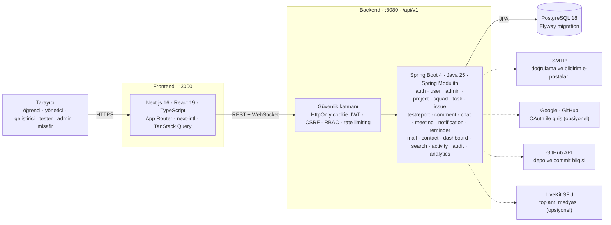

<p align="center">
  <a href="https://pd-assistant.com/"><strong>🌐 Canlı: pd-assistant.com</strong></a>
</p>

<p align="center">
  <strong>🇹🇷 Türkçe</strong> ·
  <a href="README_EN.md">🇬🇧 English</a>
</p>

<p align="center">
  
</p>

<h1 align="center">
  
</h1>

<p align="center">
  <strong>Öğrenciler ve küçük yazılım ekipleri için açık kaynak, self-hosted proje yönetim platformu.</strong><br />
  Görev, sohbet, görüntülü toplantı ve GitHub takibi: dört ayrı aracın işi, tek çalışma alanında.
</p>

<p align="center">
  <a href="#-hızlı-başlangıç"><strong>🚀 Hızlı başlangıç</strong></a> ·
  <a href="#-pda-neyi-farklı-yapar"><strong>✨ Farklarımız</strong></a> ·
  <a href="#ekranlar"><strong>🖼️ Ekranlar</strong></a> ·
  <a href="#-katkıda-bulunma"><strong>🤝 Katkı</strong></a>
</p>

<p align="center">
  
</p>

---

## 🧭 PDA Neyi Farklı Yapar?

Çoğu ekip işini beş araca bölerek yürütür. Görev bir yerde, sohbet başka yerde, toplantı bir bağlantıda, kod bir başka sitede. İş yapmak yerine araçlar arasında dolaşılır. PDA bunların hepsini **tek çalışma alanında** toplar ve üstüne kendi sunucunuzda çalışma özgürlüğünü ekler.

<p align="center">
  
</p>

| | Dağınık araç yığını | PDA |
|---|---|---|
| **Görev, sohbet, toplantı, kod** | 4 ayrı uygulama, 4 abonelik, 4 giriş | Tek çalışma alanı, tek hesap |
| **Dışarıdan katılımcı** | Karşı tarafın da hesap açması gerekir | Link at, misafir **hesapsız** katılsın |
| **Görev detayı** | Ya çok sade ya çok karmaşık | **Basit** ya da **Gelişmiş**, sen seç |
| **Kod takibi** | Ayrı bir sekme ve ayrı bildirim | Depo, görevin yanında; yeni commit ekibe bildirilir |
| **Dosya paylaşımı** | Ayrı sohbet uygulamasında | Proje sohbetinde, doğrudan konuşmanın içinde |
| **Maliyet ve veri** | Kullanıcı başı ücret, veri başkasında | Ücretsiz, açık kaynak, **verin sunucunda** |

---

### 🎥 Link at. Misafir hesapsız katılsın.

Projeye bağlı ya da tamamen bağımsız toplantılar kurun. Ekip odaya girer; dışarıdan biri yalnızca bağlantıyla, hesap açmadan misafir olarak katılır.

<p align="center">
  
</p>

- Proje toplantısı ve bağımsız toplantı bir arada; yaklaşan ve canlı toplantılar tek listede.
- Misafir bağlantısı toplantıya özeldir; misafirin yalnızca o odayla sınırlı bir oturumu olur.
- Toplantı sohbeti, tepkiler ve e-posta hatırlatmaları.
- Görüntülü medya (LiveKit) **isteğe bağlıdır ve varsayılan olarak kapalıdır**; kurulum için [Toplantı medyası](#-toplantı-medyası-livekit-opsiyonel) bölümüne bakın.

### 💬 Proje sohbeti. Özel mesaj. Dosya da orada.

Her projenin kendi grup sohbeti var. İstediğinizle birebir yazın, dosyayı doğrudan konuşmaya bırakın.

<p align="center">
  
</p>

- Grup sohbeti ve aynı projedeki üyeler arasında birebir yazışma.
- Yanıt, tepki ve **dosya ekleri**; yazıyor göstergesi.
- Anlık bildirimler, hatırlatıcılar ve takvim.

### 📋 Basit görev. Gelişmiş görev. Sen seç.

Küçük işte başlık yeter. Büyük işte sorumlular, öncelik, tarih, tahmin ve alt görevler gelir. Hangi modun açık olacağını her proje için siz belirlersiniz.

<p align="center">
  
</p>

- **Basit:** başlık, açıklama, öncelik, durum ve atanan kişiler.
- **Gelişmiş:** alt görev, etiket, tahmini süre ve puan, sprint.
- Liste, sürükle-bırak Kanban panosu, sprint, havuz (backlog) ve takvim görünümleri; dosya ekleri.

### 🐙 Kod, işin yanında.

Herkese açık bir GitHub deposunu projeye bağlayın (salt okunur). Temel modda ana dalı izleyin; gelişmiş modda dalları ve birleştirilmemiş commit'leri görün. Yeni commit geldiğinde ekibin haberi olur.

<p align="center">
  
</p>

### 🏢 Organizasyonunu kur. Projeleri bir çatıda topla.

Kulüp, ekip ya da şirket: kendi profili, logosu ve kapağıyla GitHub benzeri bir organizasyon yapısı.

<p align="center">
  
</p>

### 🔓 Kodu açık. Sunucun senin.

Apache 2.0 lisanslı. Docker ile kendi sunucunuza kurun, verileriniz sizde kalsın. Kayıt e-postaları da **kendi SMTP hesabınızla** gider.

<p align="center">
  
</p>

---

<a id="ekranlar"></a>

## 🖼️ Ekran Görüntüleri

<table>
  <tr>
    <td width="50%"></td>
    <td width="50%"></td>
  </tr>
  <tr>
    <td align="center" colspan="2"><sub>Karşılama sayfası · Light ve Dark</sub></td>
  </tr>
  <tr>
    <td width="50%"></td>
    <td width="50%"></td>
  </tr>
  <tr>
    <td align="center" colspan="2"><sub>Genel bakış · Light ve Dark</sub></td>
  </tr>
  <tr>
    <td width="50%"></td>
    <td width="50%"></td>
  </tr>
  <tr>
    <td align="center" colspan="2"><sub>Görev panosu · Light ve Dark</sub></td>
  </tr>
</table>

<details>
<summary><strong>Daha fazla ekran</strong></summary>

<br />

<table>
  <tr>
    <td width="50%"></td>
    <td width="50%"></td>
  </tr>
  <tr>
    <td align="center" colspan="2"><sub>Proje genel bakışı · Light ve Dark</sub></td>
  </tr>
  <tr>
    <td width="50%"></td>
    <td width="50%"></td>
  </tr>
  <tr>
    <td align="center" colspan="2"><sub>Görev listesi · Light ve Dark</sub></td>
  </tr>
  <tr>
    <td width="50%"></td>
    <td width="50%"></td>
  </tr>
  <tr>
    <td align="center" colspan="2"><sub>Proje kriterleri · Light ve Dark</sub></td>
  </tr>
  <tr>
    <td width="50%"></td>
    <td width="50%"></td>
  </tr>
  <tr>
    <td align="center" colspan="2"><sub>Takvim · Light ve Dark</sub></td>
  </tr>
</table>

**Mobil görünüm**

<table>
  <tr>
    <td align="center" width="33%"></td>
    <td align="center" width="33%"></td>
    <td align="center" width="33%"></td>
  </tr>
</table>

</details>

---

## 🎯 Neden PDA?

PDA'nın hedef kitlesi **öğrenciler ve küçük yazılım ekipleri**. Özellikle üniversite projelerinde veya küçük ekip çalışmalarında şu sorunları azaltmayı hedefliyoruz:

- Görevlerin WhatsApp / Discord mesajları arasında kaybolması
- Kimin hangi işten sorumlu olduğunun belirsizleşmesi
- Proje ilerleyişinin takip edilememesi
- Test ve hata süreçlerinin dağınık yürütülmesi
- Ücretli proje yönetim araçlarının küçük ekipler için gereksiz karmaşık veya maliyetli olması

PDA bu süreci **tek yerde, açık kaynak ve kurulabilir** hale getirir.

### Temel prensipler

- **Açık kaynak:** Apache License 2.0
- **Ücretsiz kullanım:** Ücretli bir servise bağımlı değildir; kendi altyapınızda çalışır
- **Self-hosted:** Verileriniz sizin sunucunuzda kalır
- **Öğrenci odaklı:** Gerçek yazılım ekiplerindeki rol ve görev akışlarını deneyimleyin
- **Modüler ama sade:** Modular Monolith mimarisi; modüller net ayrılır, kurulum tek backend ile basit kalır
- **Katkıya açık:** Issue ve Pull Request desteği
- **Güvenli varsayılanlar:** Secret yönetimi, cookie tabanlı auth, validation ve RBAC

---

## ✨ V1 Özellikleri

> Sürümün ayrıntılı değişiklik listesi [Releases](https://github.com/alperrte/project-delivery-assistant/releases) sayfasındadır. Burada yalnızca ana başlıklar yer alır.

### 📋 Görev yönetimi: Basit ve Gelişmiş

Her proje için hangi modun açık olacağını siz seçersiniz. Bir göreve tek veya birden fazla kişi atanabilir.

- **Basit:** Başlık, açıklama, öncelik, durum ve atanan kişiler. Hızlı iş girmek için idealdir.
- **Gelişmiş:** Basit görevdeki her şeye ek olarak alt görev, etiket, tahmini süre ve puan, sprint. Ayrıntılı planlama için idealdir.

Liste, sürükle-bırak pano, sprint ve havuz (backlog) görünümleriyle işin kimde olduğu her an görünür.

### 🐙 GitHub repo takibi: Basit ve Gelişmiş

Herkese açık bir GitHub deposu projeye bağlanır (salt okunur).

- **Basit:** Ana daldaki son commit'ler.
- **Gelişmiş:** Dallar, merge edilen ve edilmeyen commit'ler, her commit'i kimin attığı.

Yeni commit geldiğinde ekibe bildirim gider.

### 🎥 Toplantılar

- Projeye bağlı ya da bağımsız toplantılar; hesapsız **misafir katılımı**.
- Toplantı sohbeti, tepkiler ve e-posta hatırlatmaları.
- Görüntülü medya isteğe bağlıdır (LiveKit).

### 💬 İletişim

- **Proje içi sohbet:** Her projenin grup sohbeti; yanıt, tepki ve dosya eki desteği.
- **Birebir yazışma:** Aynı projedeki üyeler arasında.
- **Bildirimler, hatırlatıcılar ve takvim.**

### 🏢 Organizasyonlar

- GitHub benzeri organizasyon profili: logo, kapak, açıklama.
- Organizasyona bağlı projeler, davet ve üyelik yönetimi.

### 🔐 Hesap ve altyapı

- **Kayıt ve giriş:** E-posta doğrulamalı kayıt, giriş, şifre sıfırlama; Google / GitHub ile giriş (opsiyonel).
- **Güvenlik:** İki adımlı doğrulama (TOTP), HttpOnly cookie oturumu, rol tabanlı yetki.
- **SMTP altyapısı:** Doğrulama ve bildirim e-postaları kendi SMTP hesabınızla gönderilir.
- **Admin paneli:** İlk yönetici hesabı `.env` üzerinden oluşturulur.
- **Docker ile kurulum.**

### 👥 Proje ve ekip

- Squad / ekip yapısı, davet ve üyelik yönetimi.
- Proje bazlı roller (bir kullanıcı aynı projede birden fazla role sahip olabilir).
- Teslim kriterleri ve tamamlanma yüzdesi, issue kayıtları, tester'lar için test raporları.

### 🎨 Arayüz

- Türkçe, İngilizce ve Almanca arayüz.
- Light / Dark / Sistem tema.
- Mobil, tablet ve masaüstü uyumlu tasarım.

---

## 🧩 Rol Yapısı

PDA'da rollerin yetkileri uygulama tarafında sabit tutulur; bir rol adı tek başına erişim vermez. Bir kullanıcı aynı projede birden fazla role sahip olabilir.

### Global roller

- `USER`
- `ADMIN` — PDA kurulumunu yönetir, projelerde örtük yetkisi yoktur

### Proje bazlı roller

- `PROJECT_MANAGER`
- `BACKEND_DEVELOPER`
- `FRONTEND_DEVELOPER`
- `FULL_STACK_DEVELOPER`
- `AI_ML_DEVELOPER`
- `UI_UX_DEVELOPER`
- `TESTER`
- `ANALYST`

Aynı kullanıcı farklı projelerde farklı rollere sahip olabilir.

---

## 🏗️ Mimari ve Teknoloji Yığını

PDA, **Modular Monolith** mimarisi ile geliştirilmiştir.

Bu yaklaşım ile:

- Modüller birbirinden net biçimde ayrılır
- Tek backend deployment korunur, kurulum ve işletme basit kalır
- Ücretsiz / düşük maliyetli deployment desteklenir
- İleride ihtiyaç oluşursa modüllerin ayrıştırılması kolaylaşır



<p align="center">
  
</p>

---

## 🔐 Güvenlik Yaklaşımı

PDA deploy edilebilir açık kaynak bir proje olduğu için güvenlik varsayılanları baştan sıkı tutulur.

- Şifreler **BCrypt** ile hashlenir.
- Access ve refresh tokenlar **HttpOnly cookie** içerisinde tutulur.
- `localStorage` ve `sessionStorage` içerisinde auth token tutulmaz.
- Cookie tabanlı auth nedeniyle CSRF koruması aktiftir.
- Misafir toplantı oturumları yalnızca ilgili toplantıya özel çerezle sınırlıdır.
- İki adımlı doğrulama sırları veritabanında şifreli saklanır.
- E-postayla gönderilen kodlar ve bağlantılar HMAC ile hashlenir.
- Production CORS explicit allowlist ile yönetilir.
- Spring Data JPA ve parameterized query kullanılır.
- Dynamic SQL string concatenation yasaktır.
- Backend input validation zorunludur.
- Auth, mesajlaşma, analitik ve iletişim uç noktalarında rate limiting uygulanır.
- Secret değerler yalnızca ENV / deployment secret store üzerinden alınır.
- Password, JWT, cookie içeriği ve secret bilgiler loglanmaz.
- Swagger varsayılan olarak kapalıdır (`API_DOCS_ENABLED=false`).

---

## 🚀 Hızlı Başlangıç

### Gereksinimler

- Git
- Docker Desktop **veya** Docker Engine + Docker Compose (backend ve PostgreSQL için)
- Node.js 22 ve npm (Next.js frontend'i çalıştırmak için)

Java ve PostgreSQL'i host makineye ayrı ayrı kurmak gerekmez; backend ve veritabanı Docker içinde çalışır, frontend Docker dışında çalışır.

### 1. Repoyu klonlayın

```bash
git clone https://github.com/alperrte/project-delivery-assistant.git
cd project-delivery-assistant
```

### 2. Environment dosyasını oluşturun

Linux / macOS:

```bash
cp .env.example .env
```

Windows PowerShell:

```powershell
Copy-Item .env.example .env
```

### 3. `.env` değerlerini doldurun

`.env.example` dosyası her değişkenin yanında açıklama içerir. Başlangıç için doldurmanız gerekenler:

| Değişken | Ne yapmalısınız |
|---|---|
| `DB_PASSWORD` | `change_me` yerine kendi veritabanı şifrenizi yazın. |
| `JWT_SECRET` | Uzun, rastgele bir değer üretin. |
| `EMAIL_VERIFICATION_HMAC_KEY` | `openssl rand -base64 32` çıktısını yazın. |
| `TOTP_ENCRYPTION_KEY` | Farklı bir `openssl rand -base64 32` çıktısı yazın. Sonradan değiştirirseniz herkesin iki adımlı doğrulaması kapanır. |
| `ADMIN_EMAIL` ve `ADMIN_INITIAL_PASSWORD` | İlk admin hesabınızın e-postası ve geçici şifresi. |
| `MAIL_ENABLED`, `SMTP_USERNAME`, `SMTP_PASSWORD`, `SMTP_FROM_ADDRESS` | Kayıt akışı için gereklidir; `MAIL_ENABLED=false` iken kayıt `503` döner. Aşağıya bakın. |

Üretilen değerler:

```bash
openssl rand -base64 32
```

Windows PowerShell'de `openssl` yoksa:

```powershell
[Convert]::ToBase64String((1..32 | ForEach-Object { Get-Random -Maximum 256 }))
```

Örnek yapı (değerleri kendinize göre değiştirin):

```env
# Application
APP_ENV=dev
BACKEND_PORT=8080
FRONTEND_PORT=3000

# PostgreSQL
DB_NAME=pda
DB_PORT=5432
DB_USERNAME=pda
DB_PASSWORD=<kendi-sifreniz>
DB_URL=jdbc:postgresql://postgres:5432/pda

# JWT
JWT_SECRET=<uzun-rastgele-deger>
JWT_ACCESS_TOKEN_EXPIRATION_MINUTES=15
JWT_REFRESH_TOKEN_EXPIRATION_DAYS=7

# Frontend / CORS
FRONTEND_URL=http://localhost:3000
ALLOWED_ORIGINS=http://localhost:3000
NEXT_PUBLIC_API_URL=http://localhost:8080/api/v1
INTERNAL_API_URL=http://backend:8080/api/v1

# API Documentation
API_DOCS_ENABLED=true

# Initial Admin
ADMIN_EMAIL=<admin-e-postasi>
ADMIN_INITIAL_PASSWORD=<gecici-sifre>

# Mail (Hostinger Email, implicit TLS)
MAIL_ENABLED=false
MAIL_PROVIDER=smtp
SMTP_FROM_ADDRESS=info@pd-assistant.com
SMTP_HOST=smtp.hostinger.com
SMTP_PORT=465
SMTP_USERNAME=info@pd-assistant.com
SMTP_PASSWORD=
SMTP_AUTH=true
SMTP_STARTTLS=false
SMTP_SSL=true
CONTACT_RECIPIENT=info@pd-assistant.com

# Güvenlik anahtarları
EMAIL_VERIFICATION_HMAC_KEY=<openssl rand -base64 32>
TOTP_ENCRYPTION_KEY=<baska bir openssl rand -base64 32>
```

#### E-posta nasıl ayarlanır?

Kayıt e-postaları kendi SMTP hesabınızla gönderilir (Hostinger, Gmail, Brevo vb.).

1. Sağlayıcınızdan SMTP bilgilerini alın ve `.env` içindeki `SMTP_HOST`, `SMTP_PORT`, `SMTP_USERNAME`, `SMTP_PASSWORD`, `SMTP_FROM_ADDRESS` alanlarına yazın.
2. Port `465` ise `SMTP_SSL=true`, `SMTP_STARTTLS=false`; port `587` ise tam tersi. İkisini birlikte açmayın.
3. `MAIL_ENABLED=true` yapıp backend'i yeniden başlatın: `docker compose up -d`.
4. Kayıt olmayı deneyin; doğrulama e-postası gelmelidir.

> SMTP şifresini Git'e koymayın ve kimseyle paylaşmayın. Brevo kullanıyorsanız ayrıca `MAIL_PROVIDER=brevo` yazın.

#### Opsiyonel ayarlar

| Değişken | Açıklama |
|---|---|
| `GOOGLE_CLIENT_ID`, `GOOGLE_CLIENT_SECRET` | Google ile giriş. İkisi de boşsa kapalıdır, ikisi de doluysa açılır. Yönlendirme adresi: `http://localhost:8080/api/v1/auth/oauth2/callback/google` |
| `GITHUB_CLIENT_ID`, `GITHUB_CLIENT_SECRET` | GitHub ile giriş. Yönlendirme adresi: `http://localhost:8080/api/v1/auth/oauth2/callback/github` |
| `GITHUB_API_TOKEN` | Proje depo sayfası için. Boşsa tüm sunucu için saatte 60 istek yapılabilir; kapsamsız (scope'suz) bir token bunu saatte 5000'e çıkarır. Yalnızca sunucuda kullanılır. |
| `ORGANIZATION_MEDIA_STORAGE_PATH` | Organizasyon logo ve kapak görsellerinin saklanacağı dizin. |
| `TRUSTED_PROXY_CIDRS` | Yalnızca backend'in önüne gerçekten bir reverse proxy koyarsanız, onun adresini yazın. Aksi halde boş bırakın. |
| `LOG_LEVEL` | Log seviyesi. |

> Gerçek `.env` dosyası hiçbir zaman Git'e commit edilmemelidir.

### 4. Backend ve PostgreSQL'i başlatın

```bash
docker compose up --build -d
```

### 5. Frontend'i başlatın

```bash
cd frontend
npm install
npm run dev
```

Frontend `http://localhost:3000` adresinde açılır ve `http://localhost:8080/api/v1` üzerindeki backend'e bağlanır. `API_DOCS_ENABLED=true` ise Swagger arayüzü backend üzerinden açılır.

### 6. Servisleri durdurun

Frontend'i terminalde `Ctrl+C` ile, backend ve PostgreSQL'i şu komutla durdurun:

```bash
docker compose down
```

---

## 🎥 Toplantı Medyası (LiveKit, opsiyonel)

Toplantı oluşturma, misafir bağlantısı, toplantı sohbeti ve hatırlatmalar LiveKit olmadan da çalışır. Görüntülü ve sesli medya için bir [LiveKit](https://livekit.io) SFU gerekir. Bu özellik **varsayılan olarak kapalıdır** (`MEETING_MEDIA_ENABLED=false`).

Yerel geliştirmede LiveKit'i ek bir Compose dosyası ve profil ile ayağa kaldırabilirsiniz:

```bash
docker compose -f docker-compose.yml -f docker-compose.meeting.yml --profile meeting up -d
```

`.env` içinde şu değişkenleri doldurun:

| Değişken | Açıklama |
|---|---|
| `MEETING_MEDIA_ENABLED` | Medya entegrasyonunu açar; varsayılan `false`. |
| `LIVEKIT_API_URL`, `LIVEKIT_WS_URL` | Backend'in LiveKit'e ulaştığı ve tarayıcıların bağlandığı adresler. |
| `LIVEKIT_API_KEY`, `LIVEKIT_API_SECRET` | LiveKit anahtar çifti. |
| `MEETING_EMPTY_GRACE`, `MEETING_RETAIN_CHAT`, `MEETING_MAX_PARTICIPANTS`, `MEETING_TOKEN_TTL` | Boş oda süresi, sohbetin saklanması, katılımcı sınırı ve katılım belirteci ömrü. |

Üretimde ayrıca `MEDIA_ADDRESS`, `TURN_ADDRESS` ve `LIVEKIT_NODE_IP` değerlerini kendi alan adlarınıza ve sunucu IP'nize göre ayarlayın; DNS, TLS ve TURN hazırlığını ayrıca yapın. Üretim Compose dosyası: `docker-compose.meeting.prod.yml`.

---

## 👑 İlk Admin Hesabı

İlk admin hesabı `.env` üzerinden oluşturulur:

```env
ADMIN_EMAIL=
ADMIN_INITIAL_PASSWORD=
```

Akış:

1. sistem admin hesabı olup olmadığını kontrol eder,
2. yoksa ENV bilgileriyle oluşturur,
3. şifre yalnızca BCrypt hash olarak saklanır,
4. ilk girişte şifre değiştirme zorunlu tutulur,
5. restart sırasında mevcut admin ENV ile overwrite edilmez.

---

## 🤝 Katkıda Bulunma

PDA açık kaynak ve katkıya açık bir projedir. Hata bildir, fikir öner, kod gönder.

Katkı akışı:

1. repository'yi fork edin,
2. yeni bir branch oluşturun,
3. değişikliğinizi geliştirin,
4. ilgili testleri çalıştırın,
5. Pull Request açın.

- Hata bildirmek ve yeni fikir önermek için GitHub Issue açın.
- Güvenlik açıklarını public issue yerine [info@pd-assistant.com](mailto:info@pd-assistant.com) adresine bildirin.

---

<h2 align="center">👨‍💻 Projeyi Geliştirenler</h2>

<div align="center">

<table align="center">
  <tr>
    <td align="center" valign="top" width="50%">
      <br />
      
      <h3>Alper Temiz</h3>
      <sub><code>Full Stack Developer</code></sub>
      <br /><br />
      <table align="center">
        <tr><td>🐙 <a href="https://github.com/alperrte">github.com/alperrte</a></td></tr>
        <tr><td>💼 <a href="https://www.linkedin.com/in/alpertemizz/">linkedin.com/in/alpertemizz</a></td></tr>
        <tr><td>✉️ <a href="mailto:alpertemiz15@gmail.com">alpertemiz15@gmail.com</a></td></tr>
        <tr><td>📄 <a href="frontend/public/cv/alper-temiz-cv.pdf">Özgeçmiş (CV)</a></td></tr>
      </table>
    </td>
    <td align="center" valign="top" width="50%">
      <br />
      
      <h3>Hamza Taşbay</h3>
      <sub><code>Full Stack Developer</code></sub>
      <br /><br />
      <table align="center">
        <tr><td>🐙 <a href="https://github.com/HmzT270">github.com/HmzT270</a></td></tr>
        <tr><td>💼 <a href="https://www.linkedin.com/in/hamza-tasbay">linkedin.com/in/hamza-tasbay</a></td></tr>
        <tr><td>✉️ <a href="mailto:tasbayh@gmail.com">tasbayh@gmail.com</a></td></tr>
        <tr><td>📄 <a href="frontend/public/cv/hamza-tasbay-cv.pdf">Özgeçmiş (CV)</a></td></tr>
      </table>
    </td>
  </tr>
</table>

</div>

---

<h2 align="center">📄 Lisans</h2>

<p align="center">
  PDA, <strong>Apache License 2.0</strong> altında lisanslanmaktadır.<br />
  Detaylar: <a href="LICENSE"><code>LICENSE</code></a>
</p>
