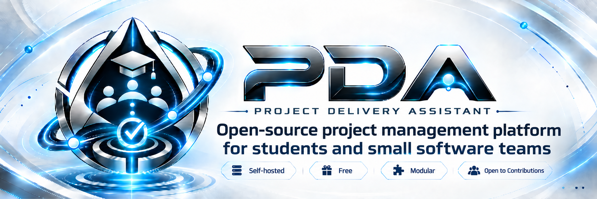
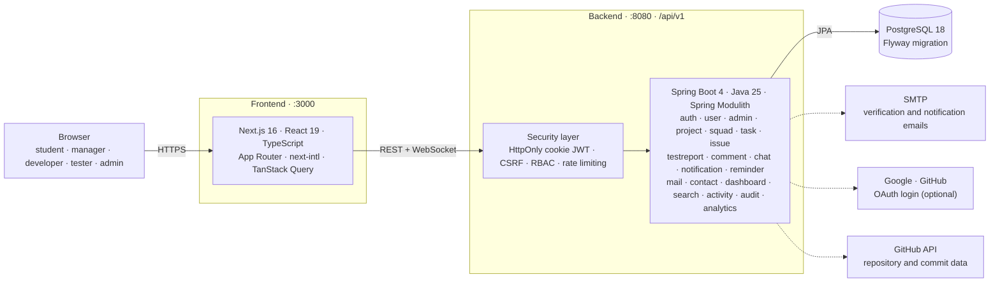

<p align="center">
  <a href="README.md">🇹🇷 Türkçe</a> ·
  <strong>🇬🇧 English</strong>
</p>

<p align="center">
  
</p>

<p align="center">
  <a href="LICENSE"></a>
  
  
  
</p>

<p align="center">
  
  
  
  
</p>

<h1 align="center">PDA — Project Delivery Assistant V1</h1>

**PDA** is a **free, open-source, self-hosted project management platform** built for students and small software teams.

You don't need separate tools to plan, assign, track and talk about your team's work. PDA keeps the whole delivery process of a project in one place, in a simple structure that students and small teams can easily set up, understand and contribute to.

### Key features

- **Simple and advanced task management** with flexible task assignment
- **GitHub repository tracking** (simple and advanced mode)
- **In-project chat** and one-to-one communication between users
- **Roles, squads, criteria, issues and test reports**
- **Secure and self-hosted:** runs on your own server with your own SMTP account

See the [V1 Features](#-v1-features) section for details.

<p align="center">
  
</p>

---

## 🖼️ Screenshots

<table>
  <tr>
    <td width="50%"></td>
    <td width="50%"></td>
  </tr>
  <tr>
    <td align="center" colspan="2"><sub>Dashboard · Light and Dark</sub></td>
  </tr>
  <tr>
    <td width="50%"></td>
    <td width="50%"></td>
  </tr>
  <tr>
    <td align="center" colspan="2"><sub>Task board · Light and Dark</sub></td>
  </tr>
</table>

<details>
<summary><strong>More screens</strong></summary>

<br />

<table>
  <tr>
    <td width="50%"></td>
    <td width="50%"></td>
  </tr>
  <tr>
    <td align="center" colspan="2"><sub>Landing page · Light and Dark</sub></td>
  </tr>
  <tr>
    <td width="50%"></td>
    <td width="50%"></td>
  </tr>
  <tr>
    <td align="center" colspan="2"><sub>Project overview · Light and Dark</sub></td>
  </tr>
  <tr>
    <td width="50%"></td>
    <td width="50%"></td>
  </tr>
  <tr>
    <td align="center" colspan="2"><sub>Task list · Light and Dark</sub></td>
  </tr>
  <tr>
    <td width="50%"></td>
    <td width="50%"></td>
  </tr>
  <tr>
    <td align="center" colspan="2"><sub>Project criteria · Light and Dark</sub></td>
  </tr>
  <tr>
    <td width="50%"></td>
    <td width="50%"></td>
  </tr>
  <tr>
    <td align="center" colspan="2"><sub>Calendar · Light and Dark</sub></td>
  </tr>
</table>

**Mobile view**

<table>
  <tr>
    <td align="center" width="33%"></td>
    <td align="center" width="33%"></td>
    <td align="center" width="33%"></td>
  </tr>
</table>

</details>

---

## 🎯 Why PDA?

PDA is aimed at **students and small software teams**. Especially in university projects and small team work, we want to reduce problems such as:

- Tasks getting lost between WhatsApp / Discord messages
- It being unclear who is responsible for what
- Project progress not being trackable
- Testing and bug processes being handled in a scattered way
- Paid project management tools being needlessly complex or expensive for small teams

PDA brings this process together **in one place, open source and self-hostable**.

### Core principles

- **Open source:** Apache License 2.0
- **Free to use:** Does not depend on any paid service; runs on your own infrastructure
- **Self-hosted:** You can run it on your own infrastructure
- **Student focused:** Experience the roles and task flows of real software teams
- **Modular but simple:** Modular Monolith architecture; modules are clearly separated, and setup stays simple with a single backend
- **Open to contributions:** Issue and Pull Request support
- **Secure defaults:** Secret management, cookie-based auth, validation and RBAC

---

## ✨ V1 Features

> The detailed change list for this version is on the [Releases](https://github.com/alperrte/project-delivery-assistant/releases) page. Only the main headings are listed here.

### 📋 Task management: Simple and Advanced

You choose which mode is enabled for each project. A task can be assigned to one or more people.

- **Simple:** Title, description, priority, status and assignees. Ideal for quickly entering work.
- **Advanced:** Everything in a simple task, plus subtasks, labels, time estimate and points, and sprints. Ideal for detailed planning.

With list, drag-and-drop board, sprint and backlog views, who owns a piece of work is always visible.

### 🐙 GitHub repository tracking: Simple and Advanced

A public GitHub repository is connected to the project (read-only).

- **Simple:** Latest commits on the main branch.
- **Advanced:** Branches, merged and unmerged commits, and who made each commit.

The team is notified when a new commit arrives.

### 💬 Communication

- **In-project chat:** A group chat for every project, with replies and reactions.
- **Direct messages:** Between members of the same project.
- **Notifications, reminders and a calendar.**

### 🔐 Account and infrastructure

- **Sign-up and login:** Email-verified registration, login, password reset; Google / GitHub login (optional).
- **Security:** Two-factor authentication (TOTP), HttpOnly cookie sessions, role-based authorization.
- **SMTP infrastructure:** Verification and notification emails are sent with your own SMTP account.
- **Admin panel:** The first administrator account is created from `.env`.
- **Docker-based setup.**

### 👥 Project and team

- Organization, invitation and membership management, squad / team structure.
- Project-based roles (a user can hold more than one role in the same project).
- Delivery criteria and completion percentage, issue records, test reports for testers.

### 🎨 Interface

- Turkish, English and German interface.
- Light / Dark / System theme.
- Responsive design for mobile, tablet and desktop.

---

## 🧩 Role Structure

In PDA, role permissions are fixed on the application side; a role name alone does not grant access. A user can hold more than one role in the same project.

### Global roles

- `USER`
- `ADMIN` — manages the PDA installation, has no implicit permissions inside projects

### Project-based roles

- `PROJECT_MANAGER`
- `BACKEND_DEVELOPER`
- `FRONTEND_DEVELOPER`
- `FULL_STACK_DEVELOPER`
- `AI_ML_DEVELOPER`
- `UI_UX_DEVELOPER`
- `TESTER`
- `ANALYST`

The same user can have different roles in different projects.

---

## 🏗️ Architecture and Tech Stack

PDA is built with a **Modular Monolith** architecture.

With this approach:

- Modules are clearly separated from each other
- A single backend deployment is kept, so setup and operation stay simple
- Free / low-cost deployment is supported
- Splitting modules apart later is easier if the need arises



<p align="center">
  
</p>

---

## 🔐 Security Approach

Because PDA is an open-source project that can be deployed, security defaults are kept strict from the start.

- Passwords are hashed with **BCrypt**.
- Access and refresh tokens are kept in **HttpOnly cookies**.
- No auth tokens are stored in `localStorage` or `sessionStorage`.
- CSRF protection is active because auth is cookie-based.
- Two-factor authentication secrets are stored encrypted in the database.
- Codes and links sent by email are hashed with HMAC.
- Production CORS is managed with an explicit allowlist.
- Spring Data JPA and parameterized queries are used.
- Dynamic SQL string concatenation is forbidden.
- Backend input validation is mandatory.
- Rate limiting is applied to auth, messaging, analytics and contact endpoints.
- Secret values are taken only from ENV / the deployment secret store.
- Passwords, JWTs, cookie contents and secrets are never logged.
- Swagger is disabled by default (`API_DOCS_ENABLED=false`).

---

## 🚀 Quick Start

### Requirements

- Git
- Docker Desktop **or** Docker Engine + Docker Compose (for the backend and PostgreSQL)
- Node.js 22 and npm (to run the Next.js frontend)

You don't need to install Java and PostgreSQL on the host machine separately; the backend and database run in Docker, while the frontend runs outside Docker.

### 1. Clone the repository

```bash
git clone https://github.com/alperrte/project-delivery-assistant.git
cd project-delivery-assistant
```

### 2. Create the environment file

Linux / macOS:

```bash
cp .env.example .env
```

Windows PowerShell:

```powershell
Copy-Item .env.example .env
```

### 3. Fill in the `.env` values

The `.env.example` file has a description next to every variable. To get started, you need to fill in:

| Variable | What to do |
|---|---|
| `DB_PASSWORD` | Replace `change_me` with your own database password. |
| `JWT_SECRET` | Generate a long, random value. |
| `EMAIL_VERIFICATION_HMAC_KEY` | Paste the output of `openssl rand -base64 32`. |
| `TOTP_ENCRYPTION_KEY` | Paste a different `openssl rand -base64 32` output. If you change it later, everyone's two-factor authentication is disabled. |
| `ADMIN_EMAIL` and `ADMIN_INITIAL_PASSWORD` | The email and temporary password of your first admin account. |
| `MAIL_ENABLED`, `SMTP_USERNAME`, `SMTP_PASSWORD`, `SMTP_FROM_ADDRESS` | Required for sign-up; while `MAIL_ENABLED=false`, sign-up returns `503`. See below. |

Generating values:

```bash
openssl rand -base64 32
```

If `openssl` is not available in Windows PowerShell:

```powershell
[Convert]::ToBase64String((1..32 | ForEach-Object { Get-Random -Maximum 256 }))
```

Example layout (change the values to your own):

```env
# Application
APP_ENV=dev
BACKEND_PORT=8080
FRONTEND_PORT=3000

# PostgreSQL
DB_NAME=pda
DB_PORT=5432
DB_USERNAME=pda
DB_PASSWORD=<your-password>
DB_URL=jdbc:postgresql://postgres:5432/pda

# JWT
JWT_SECRET=<long-random-value>
JWT_ACCESS_TOKEN_EXPIRATION_MINUTES=15
JWT_REFRESH_TOKEN_EXPIRATION_DAYS=7

# Frontend / CORS
FRONTEND_URL=http://localhost:3000
ALLOWED_ORIGINS=http://localhost:3000
NEXT_PUBLIC_API_URL=http://localhost:8080/api/v1
INTERNAL_API_URL=http://backend:8080/api/v1

# API Documentation
API_DOCS_ENABLED=true

# Initial Admin
ADMIN_EMAIL=<admin-email>
ADMIN_INITIAL_PASSWORD=<temporary-password>

# Mail (Hostinger Email, implicit TLS)
MAIL_ENABLED=false
MAIL_PROVIDER=smtp
SMTP_FROM_ADDRESS=info@pd-assistant.com
SMTP_HOST=smtp.hostinger.com
SMTP_PORT=465
SMTP_USERNAME=info@pd-assistant.com
SMTP_PASSWORD=
SMTP_AUTH=true
SMTP_STARTTLS=false
SMTP_SSL=true
CONTACT_RECIPIENT=info@pd-assistant.com

# Security keys
EMAIL_VERIFICATION_HMAC_KEY=<openssl rand -base64 32>
TOTP_ENCRYPTION_KEY=<another openssl rand -base64 32>
```

#### How to set up email (Hostinger Email)

1. Enter the `info@pd-assistant.com` mailbox password only in `SMTP_PASSWORD` in your local `.env.dev` / `.env.prod`. Never commit it or share it in chat.
2. Hostinger uses `smtp.hostinger.com:465`, `SMTP_SSL=true`, `SMTP_STARTTLS=false`. For port 587 instead use `SMTP_SSL=false`, `SMTP_STARTTLS=true`; never enable both TLS modes.
3. Verify the sender/domain and MX/SPF/DKIM/DMARC status in Hostinger, then set `MAIL_ENABLED=true`. Synchronize the active copy with `ops/env.ps1 use dev`; recreate the backend to load the new environment.
4. Verify real registration/contact delivery and SPF/DKIM/DMARC results in received message headers.

`SMTP_FROM_ADDRESS` selects the visible sender; the provider's SMTP login may differ. Legacy `MAIL_FROM` remains supported when the new key is absent. `MAIL_PROVIDER=brevo` uses Brevo's SMTP relay through the same Spring Mail path; supply the actual account SMTP host/login/SMTP key. There is no Brevo HTTP API or automatic fallback. See the [SMTP handoff](docs/compliation/2026-10-12-hostinger-corporate-mail.md).

#### Optional settings

| Variable | Description |
|---|---|
| `GOOGLE_CLIENT_ID`, `GOOGLE_CLIENT_SECRET` | Google login. Disabled if both are empty, enabled if both are set. Redirect URI: `http://localhost:8080/api/v1/auth/oauth2/callback/google` |
| `GITHUB_CLIENT_ID`, `GITHUB_CLIENT_SECRET` | GitHub login. Redirect URI: `http://localhost:8080/api/v1/auth/oauth2/callback/github` |
| `GITHUB_API_TOKEN` | For the project repository page. If empty, the whole server can make 60 requests per hour; a token without scopes raises this to 5000 per hour. Used only on the server. |
| `TRUSTED_PROXY_CIDRS` | Only if you really put a reverse proxy in front of the backend, enter its address. Otherwise leave it empty. |
| `LOG_LEVEL` | Log level. |

> The real `.env` file must never be committed to Git.

### 4. Start the backend and PostgreSQL

```bash
docker compose up --build -d
```

### 5. Start the frontend

```bash
cd frontend
npm install
npm run dev
```

The frontend opens at `http://localhost:3000` and connects to the backend at `http://localhost:8080/api/v1`. If `API_DOCS_ENABLED=true`, the Swagger UI is served by the backend.

### 6. Stop the services

Stop the frontend with `Ctrl+C` in its terminal, and stop the backend and PostgreSQL with:

```bash
docker compose down
```

---

## 👑 First Admin Account

The first admin account is created from `.env`:

```env
ADMIN_EMAIL=
ADMIN_INITIAL_PASSWORD=
```

Flow:

1. the system checks whether an admin account exists,
2. if not, it creates one from the ENV values,
3. the password is stored only as a BCrypt hash,
4. changing the password is required on first login,
5. an existing admin is not overwritten from ENV on restart.

---

## 🤝 Contributing

PDA is an open-source project and open to contributions.

Contribution flow:

1. fork the repository,
2. create a new branch,
3. develop your change,
4. run the relevant tests,
5. open a Pull Request.

- Open a GitHub Issue to report a bug or suggest a new idea.
- Report security vulnerabilities to [info@pd-assistant.com](mailto:info@pd-assistant.com) instead of a public issue.

---

## 👨‍💻 Developers

<div align="center">

<table>
  <tr>
    <td align="center" valign="top" width="50%">
      <br />
      
      <h3>Alper Temiz</h3>
      <sub><code>Full Stack Developer</code></sub>
      <br /><br />
      <table>
        <tr><td>🐙 <a href="https://github.com/alperrte">github.com/alperrte</a></td></tr>
        <tr><td>💼 <a href="https://www.linkedin.com/in/alpertemizz/">linkedin.com/in/alpertemizz</a></td></tr>
        <tr><td>✉️ <a href="mailto:alpertemiz15@gmail.com">alpertemiz15@gmail.com</a></td></tr>
        <tr><td>📄 <a href="frontend/public/cv/alper-temiz-cv.pdf">Resume (CV)</a></td></tr>
      </table>
    </td>
    <td align="center" valign="top" width="50%">
      <br />
      
      <h3>Hamza Taşbay</h3>
      <sub><code>Full Stack Developer</code></sub>
      <br /><br />
      <table>
        <tr><td>🐙 <a href="https://github.com/HmzT270">github.com/HmzT270</a></td></tr>
        <tr><td>💼 <a href="https://www.linkedin.com/in/hamza-tasbay">linkedin.com/in/hamza-tasbay</a></td></tr>
        <tr><td>✉️ <a href="mailto:tasbayh@gmail.com">tasbayh@gmail.com</a></td></tr>
        <tr><td>📄 <a href="frontend/public/cv/hamza-tasbay-cv.pdf">Resume (CV)</a></td></tr>
      </table>
    </td>
  </tr>
</table>

</div>

---

<p align="center">
  
</p>

<p align="center">
  <strong>Open-source project management for students and small software teams.</strong>
</p>

---

<h2 align="center">📄 License</h2>

<p align="center">
  PDA is licensed under the <strong>Apache License 2.0</strong>.<br />
  Details: <a href="LICENSE"><code>LICENSE</code></a>
</p>
